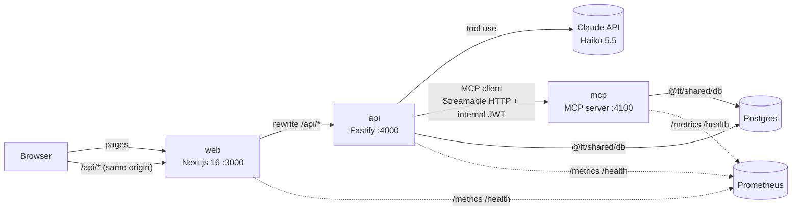

# Financial Tracker

[](https://github.com/raymondwongso/financial-tracker/actions/workflows/ci.yml)
[](https://github.com/raymondwongso/financial-tracker/actions/workflows/security.yml)

Track your income and expenses by **chatting with an assistant**. Tell it "I spent 12.50 on lunch from
Wallet and paid 1,500,000 rent from BCA" and it records both transactions through our own **MCP server**.
Each action comes back as a card you can open in a side pane. Dashboard, Accounts and Transactions pages
are there when you want the classic view.

Built with Next.js, Fastify, Postgres and the Model Context Protocol, using an agentic engineering workflow
(Claude Code skills, agents and safety hooks; see [Agentic workflow](#agentic-workflow)).

## Features

- **Chat first.** After login you land on the assistant. One message can create several accounts or
  transactions.
- **Action cards and snapshot pane.** Every action (account created, transaction recorded, transactions
  listed, monthly summary) becomes a card. Clicking a card opens a snapshot of that moment in the right-hand
  pane, which keeps every card of the conversation.
- **The assistant asks before guessing.** Listing transactions needs an account and a date range, and a
  summary needs a month. If something is missing, the assistant asks for it.
- **Running balances.** Statements show opening balance, the balance after each transaction, and closing
  balance.
- **Persisted chat history** with scroll-up pagination (20 messages per page).
- **Multi-currency** accounts with local symbols (`$`, `Rp`, `€`, `¥`, …); totals are never mixed across
  currencies.
- **Multi-user** with per-user data isolation (every query is scoped by user).
- **Observability:** structured JSON logs and Prometheus `/metrics` on every service, plus Core Web Vitals
  from the browser.

## Architecture



How a chat message flows:

1. The web app sends `POST /api/chat { message }`. Next.js rewrites the call to the API, so the session
   cookie stays first-party.
2. The API loads the last 20 stored messages as context. It calls Claude with the MCP server's tools,
   discovered through the MCP TypeScript client.
3. Claude picks tools (one call per account or transaction). The API calls our MCP server with a
   short-lived **internal JWT** carrying the user id, so tools can only touch that user's data.
4. Each MCP tool returns text for Claude plus `structuredContent` (raw snapshot data). The API turns each
   successful call into a **card**.
5. The user message, the assistant reply and the cards are saved in one transaction, then returned to the
   UI.

| Package      | Path      | Responsibility                                                                                                                                                        |
| ------------ | --------- | --------------------------------------------------------------------------------------------------------------------------------------------------------------------- |
| `@ft/shared` | `shared/` | zod schemas and types for every boundary; `@ft/shared/db` Drizzle schema and user-scoped repositories; `@ft/shared/server` logger, metrics and internal-token helpers |
| `@ft/api`    | `api/`    | REST API: auth (argon2 + JWT httpOnly cookie), accounts, transactions, summary, chat; SQL migrations                                                                  |
| `@ft/mcp`    | `mcp/`    | MCP server: `create_account`, `create_transaction`, `list_transactions`, `monthly_summary`, `list_accounts`                                                           |
| `@ft/web`    | `web/`    | Next.js App Router + Bootstrap 5 UI, built from the approved design                                                                                                   |

## Getting started

Requirements: Node 24 (`nvm use`), pnpm 12, Docker.

```bash
make install            # pnpm install + creates .env from .env.example
make run-database       # Postgres 17 in Docker (dev + test databases)
make migrate-database   # apply api/migration to both databases

# three terminals (hot reload)
make run-mcp-dev        # :4100
make run-api-dev        # :4000
make run-web-dev        # :3000  → http://localhost:3000
```

The default `.env` uses `LLM_PROVIDER=fake`, so no API key is needed. To use real Claude, set:

```bash
LLM_PROVIDER=anthropic
ANTHROPIC_API_KEY=sk-ant-...
LLM_MODEL=claude-haiku-5-5
```

### Chatting with the fake LLM

`FakeLlm` (`api/src/chat/fake-llm.ts`) replaces only Claude's "understand the message" step. It matches
your message against fixed patterns and calls the same MCP tools Claude would, so accounts, transactions,
cards and history are all real. Matching is case-insensitive. Messages that match nothing get a short help
reply.

| What you want     | Type exactly like this                                       | MCP tool → card                                      |
| ----------------- | ------------------------------------------------------------ | ---------------------------------------------------- |
| Create an account | `Create a cash account called Wallet in USD`                 | `create_account` → Account created                   |
|                   | `Create a bank account called BCA in IDR`                    |                                                      |
|                   | `create an account called Savings` (defaults: bank, USD)     |                                                      |
| Record an expense | `I spent 12.50 on Food from Wallet`                          | `create_transaction` → Expense recorded              |
|                   | `paid 1500000 on Rent from BCA`                              |                                                      |
| Record income     | `got paid 5000 into Wallet`                                  | `create_transaction` → Income recorded               |
|                   | `received 250 into Wallet` / `earned 100 to Wallet`          |                                                      |
| List transactions | `show transactions for Wallet from 2026-10-01 to 2026-10-31` | `list_transactions` → Transactions (running balance) |
| Monthly summary   | `Summarise 2026-10`                                          | `monthly_summary` → Monthly summary                  |
| List accounts     | `What accounts do I have?`                                   | `list_accounts` → no card (reply only)               |

Notes:

- **Several actions in one message:** join them with `and`, `;` or `. `, e.g.
  `Create a bank account called BCA in IDR and a cash account called Wallet in USD` or
  `I spent 12.50 on Food from Wallet and I spent 4.80 on Coffee from Wallet; paid 1500000 on Rent from BCA`.
- **Clarifying questions:** `Show my transactions` (no account or dates) makes the assistant ask
  _"which account, and what date range?"_. `How did I do?` (no month) makes it ask
  _"Which month and year should I summarise?"_.
- **Amounts** are plain numbers in the account's currency: `12.50`, `1500000` (no thousands separators or
  currency symbols). Transactions are dated today. The category is the single word after "on", e.g. `Food`.
- **Dates** for listing must be `YYYY-MM-DD`, and the month for summaries `YYYY-MM`.
- The account name must match an existing account (case-insensitive). Otherwise the assistant replies with
  the list of your accounts.

Run the whole stack in Docker instead: `make up` (then `make logs`, `make down`).

### Make targets

| Target                                                         | What                                      |
| -------------------------------------------------------------- | ----------------------------------------- |
| `install`, `run-database`, `stop-database`, `migrate-database` | setup and database                        |
| `run-{api,mcp,web}-dev`                                        | dev servers with hot reload               |
| `build-{api,mcp,web}`, `build`, `run-{api,mcp,web}`            | production builds and running them        |
| `up`, `down`, `logs`                                           | full stack in Docker Compose              |
| `lint`, `typecheck`                                            | ESLint and TypeScript across all packages |
| `test-hooks`, `test-integration`, `test-e2e`, `test`           | test suites (see below)                   |

## Testing

| Suite  | Tool                    | What it covers                                                                                                                            |
| ------ | ----------------------- | ----------------------------------------------------------------------------------------------------------------------------------------- |
| hooks  | Vitest                  | safety-hook decision rules (dangerous commands, protected files, test weakening)                                                          |
| shared | Vitest                  | schemas, money and date helpers, internal tokens                                                                                          |
| mcp    | Vitest + MCP SDK client | every tool against the real test DB, structured snapshots, auth, user isolation                                                           |
| api    | Vitest + `app.inject`   | auth, accounts, transactions + running balance, summary, chat (with an in-process MCP server), history pagination, rate limits, isolation |
| web    | Playwright              | full stack in a browser: auth, chat cards and pane, statements, summaries, history paging, pages                                          |

```bash
make test-integration   # shared + mcp + api against the real Postgres test database
make test-e2e           # starts mcp/api/web on test ports and runs Playwright in Docker
make test               # all of the above + the test-count ratchet
```

The e2e runner uses the official Playwright Docker image, so no browser system libraries are needed. Set
`E2E_LOCAL=1` to use a locally installed browser. `scripts/check-test-count.mjs` fails the build if any
suite has fewer tests than `tests-baseline.json`.

## Continuous integration

GitHub Actions runs on every pull request to `main` and on every push to `main`:

| Workflow | Job                      | What it does                                                                      | Run it locally                                                |
| -------- | ------------------------ | --------------------------------------------------------------------------------- | ------------------------------------------------------------- |
| CI       | `quality`                | ESLint, TypeScript, Prettier, test-count ratchet                                  | `make lint typecheck && pnpm format:check && pnpm test:count` |
| CI       | `integration`            | hook tests + shared/mcp/api Vitest suites against a Postgres 17 service container | `make test-integration`                                       |
| CI       | `docker (api\|mcp\|web)` | builds all three production images (no push)                                      | `make build` / `docker build -f api/Dockerfile .`             |
| Security | `codeql`                 | CodeQL static analysis (`security-extended` queries) for JS/TS; also runs weekly  | —                                                             |
| Security | `dependency-review`      | blocks PRs that add dependencies with high/critical advisories                    | —                                                             |
| Security | `audit`                  | `pnpm audit` of production dependencies (warning only)                            | `pnpm audit --prod --audit-level high`                        |

Dependabot opens grouped weekly update PRs for npm packages, GitHub Actions and Docker base images.
CI needs no secrets: tests use the scripted fake LLM and a throwaway database. The Playwright suite runs
locally with `make test-e2e`.

## Observability

| Service     | Endpoints                         | Metrics                                                                                                    |
| ----------- | --------------------------------- | ---------------------------------------------------------------------------------------------------------- |
| api `:4000` | `/health` (checks DB), `/metrics` | Node process metrics, `http_requests_total`, `http_request_duration_seconds` by method, route and status   |
| mcp `:4100` | `/health`, `/metrics`             | as above + `mcp_tool_calls_total{tool,outcome}`                                                            |
| web `:3000` | `/health`, `/metrics`, `/vitals`  | Node process metrics, `web_vitals_value` histogram + `web_vitals_reports_total` (LCP, INP, CLS, FCP, TTFB) |

All services log structured JSON with Pino (`service` field; passwords, cookies and auth headers
redacted). Point your own Prometheus and Grafana at the `/metrics` endpoints.

## Tooling

- **Runtime:** Node 24 (nvm, `.nvmrc`), pnpm 12 workspaces, TypeScript 6 (strict)
- **Backend:** Fastify 5, zod 4 (`fastify-type-provider-zod`), Drizzle ORM + drizzle-kit migrations,
  Postgres 17, `@node-rs/argon2`, `@fastify/jwt` + cookie, helmet, rate-limit
- **AI:** Anthropic TypeScript SDK (Claude Haiku 5.5, tool use), Model Context Protocol TypeScript SDK
  (server + client, Streamable HTTP)
- **Frontend:** Next.js 16 (App Router, `proxy.ts`), React 19, Bootstrap 5 (Sass), `next/font`
- **Testing:** Vitest (built on Vite), Playwright
- **Observability:** Pino, prom-client (Prometheus), Next.js `useReportWebVitals`
- **Quality:** ESLint (typescript-eslint), Prettier
- **Build and run:** tsup bundles for api/mcp, Next standalone output, multi-stage Dockerfiles,
  Docker Compose, Makefile

## Agentic workflow

This project is built with Claude Code using a guarded, test-first workflow:

- **`AGENT.md`** (imported by `CLAUDE.md`): stack, commands and the rules agents follow (per-user scoping,
  validation at boundaries, design-first, commit per deliverable, never weaken tests).
- **Skills** (`.claude/skills/`): `add-api-endpoint`, `add-mcp-tool`, `integration-test`, `code-review`
  (with TypeScript, Node, Fastify, Drizzle and Next.js references), `security-review` (OWASP Top 10 mapped
  to this stack), `commit-message`.
- **Agents** (`.claude/agents/`): `api-engineer`, `web-engineer`, `test-runner` (read-only, reports
  results), `code-reviewer` (read-only, applies both review skills).
- **Hooks** (`.claude/settings.json`):
  - `guard.mjs` blocks dangerous shell commands (sudo, `git push`, force or hard resets,
    `docker compose down -v`, `curl | sh`, destructive SQL outside the test DB);
  - it also blocks edits to secrets, `.git` and committed migrations, and edits that skip or delete tests;
  - `format.mjs` runs Prettier + ESLint on every edited file.

  The hook rules have their own unit tests.

- **Design first:** UI changes are designed and approved in a claude.ai design canvas before any code is
  written.
